# Genova_Rag

**Yoka** — per-user document assistant. Upload PDFs (and DOCX/TXT/MD), ingest them into a hybrid RAG pipeline, then chat with streaming answers and page citations from a Next.js desk UI (viewer + chat sessions + sticky notes + knowledge graph).

| | |
|--|--|
| Frontend | http://localhost:3000 |
| Backend API | http://localhost:7860 |
| Swagger | http://localhost:7860/docs |
| Health | http://localhost:7860/api/v1/health/status |

---

## Architecture

> GraphRAG internals: [docs/graph-rag-architecture.md](docs/graph-rag-architecture.md). Dashboard behaviour: [docs/dashboard-functionality.md](docs/dashboard-functionality.md).

```mermaid
flowchart TD

subgraph group_frontend["Frontend — Next.js 16 desk"]
  node_frontend_app["App Router<br/>dashboard / documents / settings / admin"]
  node_frontend_chat["Chat UI<br/>sessions · SSE stream · citations"]
  node_frontend_documents["Docs UI<br/>sidebar · PDF viewer · compare"]
  node_frontend_notes["Sticky notes<br/>CKEditor 5 · notes-store"]
  node_frontend_graph["Knowledge graph<br/>KnowledgeGraph.tsx · xyflow"]
  node_frontend_drive["Drive settings<br/>OAuth connect · sync"]
  node_frontend_state["Zustand<br/>auth · chat · notes · workspace"]
  node_frontend_api["API client<br/>lib/api.ts · JWT refresh"]
end

subgraph group_backend["Backend — FastAPI"]
  node_backend_main["App entry<br/>main.py · middleware · /metrics"]
  node_backend_routes["Routes /api/v1"]
  node_backend_auth["Auth<br/>JWT / bcrypt / Google"]
  node_backend_documents["Documents<br/>upload · trash · PDF serve"]
  node_backend_chat["Chat<br/>ask / stream · sessions · export"]
  node_backend_notes["Notes<br/>GET/PUT sticky JSON"]
  node_backend_drive["Drive<br/>OAuth · folder sync"]
  node_backend_graph_api["Graph API<br/>overview · neighbourhood · reindex"]
  node_backend_workspaces["Workspaces<br/>members · invites"]
  node_backend_usage["Usage / Admin<br/>quotas · KPIs"]
  node_backend_health["Health<br/>DB · Redis · Chroma · Ollama"]
  node_backend_ingestion["Ingestion<br/>document_ingestion.py"]
  node_backend_rag_retrieval["Retrieval<br/>hybrid RRF · optional rerank"]
  node_backend_rag_generation["Generation<br/>agent · prompts · SSE"]
  node_backend_graph_rag["GraphRAG<br/>extract → resolve → SQL store"]
  node_backend_queue["Queue<br/>Celery / Redis<br/>or eager in-process"]
end

subgraph group_storage["Data & providers"]
  node_storage_db[("SQLAlchemy<br/>SQLite / MySQL<br/>users · docs · graph · sessions")]
  node_storage_vector[("ChromaDB<br/>per-user vectors")]
  node_storage_bm25[("BM25 indexes<br/>per document")]
  node_storage_s3[("S3 NoteBase<br/>{user_id}/pdfs<br/>{user_id}/sticky_notes")]
  node_storage_local[("Local disk<br/>./data/uploads<br/>when S3 unset")]
  node_storage_cache[("Cache<br/>Redis / LRU")]
  node_llm["LLM + embeddings<br/>Ollama default<br/>HF / Bedrock optional"]
  node_gdrive["Google Drive API<br/>PDF import"]
end

node_frontend_app --> node_frontend_chat
node_frontend_app --> node_frontend_documents
node_frontend_app --> node_frontend_notes
node_frontend_app --> node_frontend_graph
node_frontend_app --> node_frontend_drive
node_frontend_chat --> node_frontend_state
node_frontend_notes --> node_frontend_state
node_frontend_app -->|"uses"| node_frontend_api
node_frontend_api -->|"JWT /api/v1/*"| node_backend_main

node_backend_main -->|"mounts"| node_backend_routes
node_backend_routes --> node_backend_auth
node_backend_routes --> node_backend_documents
node_backend_routes --> node_backend_chat
node_backend_routes --> node_backend_notes
node_backend_routes --> node_backend_drive
node_backend_routes --> node_backend_graph_api
node_backend_routes --> node_backend_workspaces
node_backend_routes --> node_backend_usage
node_backend_routes --> node_backend_health

node_backend_documents -->|"enqueue"| node_backend_queue
node_backend_queue -->|"runs"| node_backend_ingestion
node_backend_ingestion -->|"metadata"| node_storage_db
node_backend_ingestion -->|"vectors"| node_storage_vector
node_backend_ingestion -->|"keywords"| node_storage_bm25
node_backend_ingestion -->|"entities"| node_backend_graph_rag
node_backend_ingestion -->|"bytes"| node_storage_s3
node_backend_ingestion -.->|"fallback"| node_storage_local
node_backend_graph_rag -->|"entities / edges"| node_storage_db

node_backend_chat -->|"retrieve"| node_backend_rag_retrieval
node_backend_rag_retrieval --> node_storage_vector
node_backend_rag_retrieval --> node_storage_bm25
node_backend_rag_retrieval -->|"graph context"| node_backend_graph_rag
node_backend_rag_retrieval -->|"context"| node_backend_rag_generation
node_backend_rag_generation -->|"stream"| node_backend_chat
node_backend_rag_generation --> node_llm
node_backend_ingestion --> node_llm

node_backend_notes -->|"notes.json"| node_storage_s3
node_backend_documents -->|"pdfs/"| node_storage_s3
node_backend_drive -->|"import PDFs"| node_gdrive
node_backend_drive -->|"upload path"| node_backend_documents
node_backend_auth --> node_storage_db
node_backend_chat --> node_storage_db
node_backend_health --> node_storage_db
node_backend_health --> node_storage_cache
node_backend_health --> node_storage_vector
node_backend_health --> node_llm
node_backend_ingestion -.->|"embed cache"| node_storage_cache

classDef toneBlue fill:#dbeafe,stroke:#2563eb,stroke-width:1.5px,color:#172554
classDef toneAmber fill:#fef3c7,stroke:#d97706,stroke-width:1.5px,color:#78350f
classDef toneMint fill:#dcfce7,stroke:#16a34a,stroke-width:1.5px,color:#14532d
classDef toneIndigo fill:#e0e7ff,stroke:#4f46e5,stroke-width:1.5px,color:#312e81
class node_backend_main,node_backend_routes,node_backend_auth,node_backend_documents,node_backend_chat,node_backend_notes,node_backend_drive,node_backend_graph_api,node_backend_workspaces,node_backend_usage,node_backend_health,node_backend_ingestion,node_backend_rag_retrieval,node_backend_rag_generation,node_backend_graph_rag,node_backend_queue toneBlue
class node_frontend_app,node_frontend_chat,node_frontend_documents,node_frontend_notes,node_frontend_graph,node_frontend_drive,node_frontend_state,node_frontend_api toneAmber
class node_storage_db,node_storage_vector,node_storage_bm25,node_storage_s3,node_storage_local,node_storage_cache,node_llm,node_gdrive toneMint
```



### System flow

1. **Upload / Drive sync** — PDF lands in S3 `NoteBase/{user_id}/pdfs/` (or local `./data/uploads`), then Celery **or** eager in-process ingest runs.
2. **Ingest** — chunk → embed (Ollama/nomic by default, cache via Redis/LRU) → Chroma + BM25 → GraphRAG extract/resolve into SQL entity tables.
3. **Ask** — hybrid retrieval (vector + BM25, optional rerank) + bounded graph neighbourhood → prompt → LLM → SSE tokens + citations to the desk chat panel.
4. **Notes** — CKEditor JSON via `/api/v1/notes` → `NoteBase/{user_id}/sticky_notes/notes.json` (browser draft fallback when S3 is unset).

Redis/Celery are optional. LLM defaults to **Ollama**; HuggingFace Inference and AWS Bedrock are supported via env.

---

## Stack

| Layer | Choices |
|-------|---------|
| Backend | FastAPI, SQLAlchemy (SQLite local / MySQL deploy), JWT + bcrypt, ChromaDB, Celery/Redis (optional), boto3 |
| RAG | Ollama (`qwen2.5:3b` + `nomic-embed-text` 768-d by default), hybrid RRF retrieval, SQL GraphRAG (`backend/app/graph/`) |
| Frontend | Next.js 16, React 19, TypeScript, Tailwind, Zustand, CKEditor 5, pdf.js, `@xyflow/react` |
| Storage | `./data/*` locally; optional AWS S3 under `NoteBase/{user_id}/…` |

---

## Features

- JWT auth (register / login / refresh), optional email verify + Google sign-in
- Document upload, trash/restore, progress polling, PDF serve
- Streaming chat with sessions, citations, quiz state, export (MD / TXT / PDF)
- CKEditor sticky notes (S3-backed when configured; document association)
- Workspace knowledge graph (entity/relationship extraction + explorer UI)
- Google Drive PDF sync (OAuth + manual / scheduled sync)
- Admin + usage surfaces; Prometheus `/metrics` + deep health checks

---

## Project structure

```text
Genova_Rag/
├── backend/
│   ├── app/
│   │   ├── main.py                 # FastAPI entry, routers, middleware
│   │   ├── config.py               # Settings from env
│   │   ├── models.py / schemas.py  # ORM + API schemas
│   │   ├── routes/                 # auth, documents, chat, notes, drive,
│   │   │                           # graph, workspaces, admin, usage, health…
│   │   ├── rag/                    # chunking, embeddings, vectordb, retrieval, llm
│   │   ├── graph/                  # GraphRAG extract → resolve → store → retrieve
│   │   ├── services/               # ingestion, s3_storage, drive_sync, memory…
│   │   └── publishing/             # chat / notes PDF export
│   ├── tests/
│   └── requirements.txt
├── frontend/
│   └── src/
│       ├── app/                    # dashboard, documents, settings, admin, auth
│       ├── components/             # chat, document, notes, graph, …
│       ├── store/                  # zustand (auth, notes, chat, …)
│       └── lib/                    # api client, notes envelope helpers
├── docs/                           # GraphRAG + dashboard notes
├── docker-compose.yml
├── Dockerfile
└── .env.example
```

---

## Getting started

### Prerequisites

- Python **3.11+**
- [uv](https://docs.astral.sh/uv/) (fast installer; keeps using `requirements.txt`)
- Node.js **20+**
- [Ollama](https://ollama.com/) with:

```bash
ollama pull qwen2.5:3b
ollama pull nomic-embed-text
```

Install uv (Windows PowerShell):

```powershell
irm https://astral.sh/uv/install.ps1 | iex
```

### Backend

```powershell
cd backend
uv venv .venv
.\.venv\Scripts\Activate.ps1
uv pip install -r requirements.txt
# Optional eval/HF extras: uv pip install -r requirements-dev.txt
uvicorn app.main:app --reload --port 7860
```

### Frontend

```powershell
cd frontend
npm install
npm run dev
```

| Service | URL |
|---------|-----|
| App | http://localhost:3000 |
| API | http://localhost:7860 |
| Docs | http://localhost:7860/docs |

Local defaults: **SQLite** (`./data/app.db`), **no Redis required**, register in the UI (no SMTP → auto-verify). Optional overrides:

```powershell
$env:LLM_MODEL = "qwen2.5:3b"
$env:EMBEDDING_MODEL = "nomic-embed-text"
$env:OLLAMA_BASE_URL = "http://localhost:11434"
$env:NEXT_PUBLIC_API_URL = "http://localhost:7860"
```

Copy [`.env.example`](.env.example) only if you want file-based config. **Do not commit secrets.**

### Docker (optional)

Requires a `.env` with at least `SECRET_KEY`, `FIELD_ENCRYPTION_KEY`, and `DATABASE_URL` (see `.env.example`).

```bash
docker compose up --build
```

---

## Storage

```text
# Local (typically under backend/)
./data/uploads/
./data/app.db
./data/chroma_db_ollama_nomic/

# S3 when AWS_S3_BUCKET / S3_BUCKET is set (prefix NoteBase)
s3://<bucket>/NoteBase/{user_id}/pdfs/<filename>
s3://<bucket>/NoteBase/{user_id}/sticky_notes/notes.json
```

Without a bucket, PDFs stay on disk and notes use on-device drafts only.

---

## Environment (common)

| Variable | Default | Notes |
|----------|---------|--------|
| `SECRET_KEY` | insecure dev default | Override in production |
| `DATABASE_URL` | `sqlite:///./data/app.db` | Or `mysql+pymysql://…` |
| `LLM_PROVIDER` / `EMBEDDING_PROVIDER` | `ollama` | Also `huggingface` / Bedrock paths |
| `LLM_MODEL` | `qwen2.5:3b` | |
| `EMBEDDING_MODEL` | `nomic-embed-text` | 768-d; keep Chroma dir in sync |
| `CHROMA_PERSIST_DIR` | `./data/chroma_db_ollama_nomic` | Separate from any MiniLM index |
| `AWS_S3_BUCKET` / `S3_BUCKET` | unset | Enables NoteBase PDFs + notes |
| `S3_BASE_PREFIX` | `NoteBase` | |
| `CELERY_BROKER_URL` / `REDIS_URL` | optional | Eager ingest if Redis is down |
| `FRONTEND_URL` | `http://localhost:3000` | |
| `NEXT_PUBLIC_API_URL` | `http://localhost:7860` | Frontend → API |

Full list: [`.env.example`](.env.example).

---

## API surface

Auth-gated routes live under `/api/v1`. Interactive docs: `/docs`.

| Area | Examples |
|------|----------|
| Auth | `POST /auth/register`, `/auth/login`, `/auth/refresh` |
| Documents | `POST /documents/upload`, `GET /documents/`, trash/restore, PDF serve |
| Chat | `POST /chat/ask/stream`, sessions, history, export |
| Notes | `GET` / `PUT` / `DELETE /notes` |
| Graph | `/graph/overview`, `/search`, `/neighborhood`, reindex |
| Drive | OAuth connect, folder link, sync |
| Admin / usage / health | `/admin/*`, `/usage/*`, `/health/status` |

---

## Scripts

| Command | Where | Purpose |
|---------|-------|---------|
| `uvicorn app.main:app --reload --port 7860` | `backend/` | API |
| `celery -A app.celery_app.celery_app worker --loglevel=info` | `backend/` | Optional ingest worker |
| `npm run dev` | `frontend/` | UI |
| `npm run test` / `npm run test:e2e` | `frontend/` | Vitest / Playwright |
| `pytest` | `backend/` | Backend tests |

---

## Troubleshooting

| Symptom | Fix |
|---------|-----|
| Cannot reach Ollama | Start Ollama; check `http://localhost:11434/api/tags` |
| Model missing | `ollama pull qwen2.5:3b` and `nomic-embed-text` |
| Empty document list / hung API | Only one uvicorn on **7860**; restart if health times out |
| Frontend cannot reach API | Backend on 7860; `NEXT_PUBLIC_API_URL=http://localhost:7860` |
| Mixing embedding dimensions | Do not reuse MiniLM Chroma dir with nomic (768-d) |
| Redis / Celery “down” | Expected locally — ingest falls back in-process |

---

**Yoka** — [Genova_Rag](https://github.com/AkashYoka/Genova_Rag)