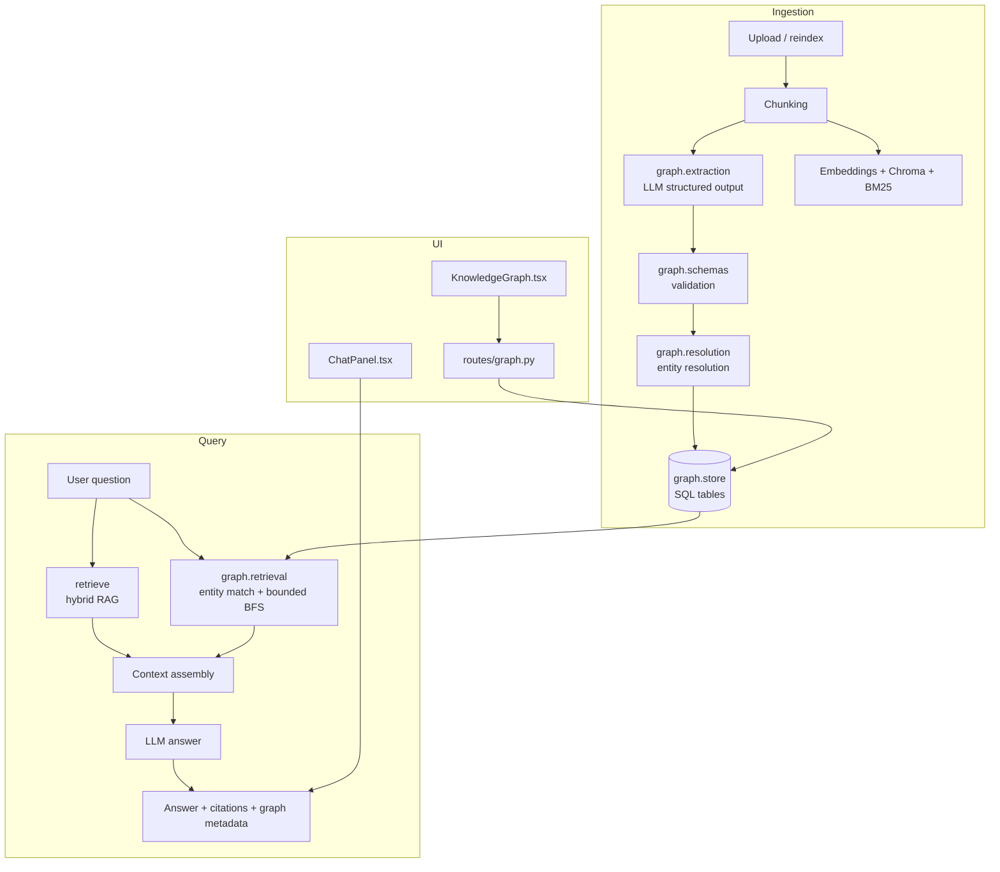
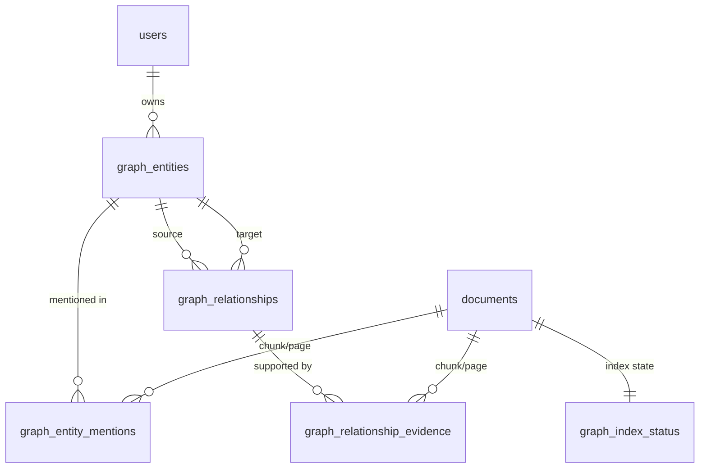
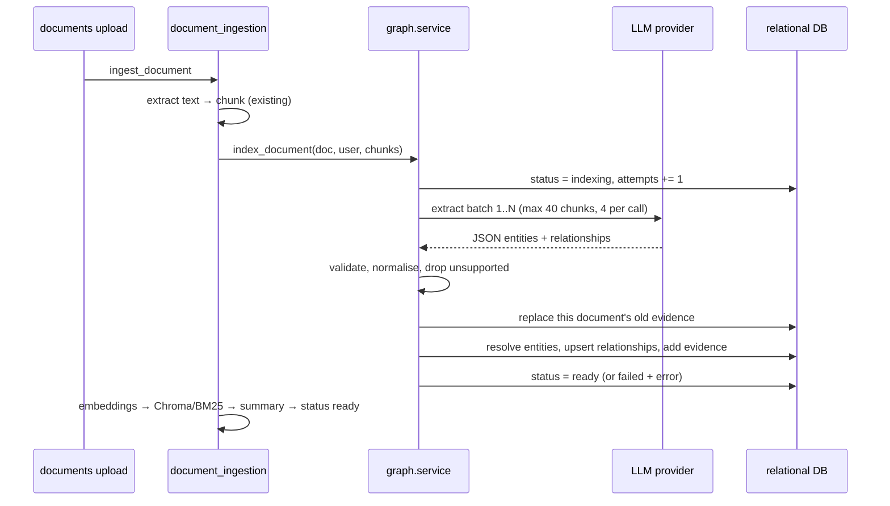
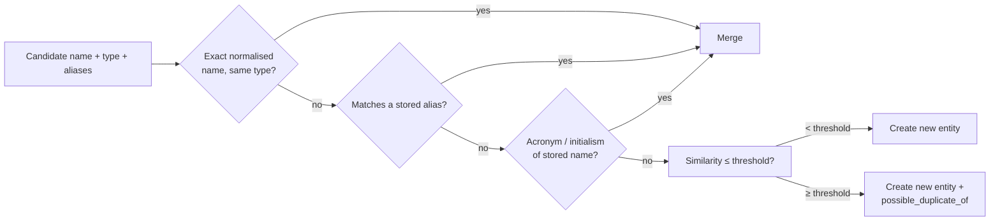
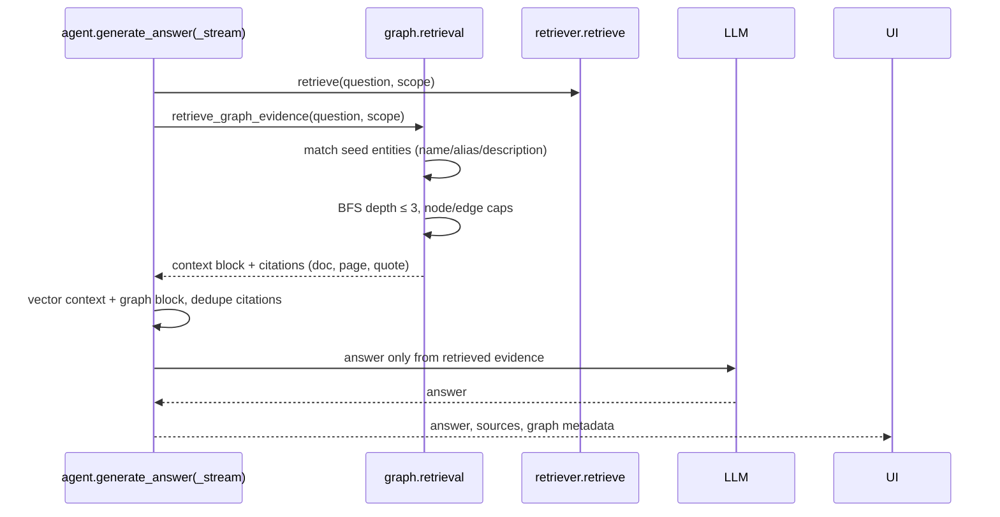

# Genova AI — Knowledge Graph / GraphRAG Architecture

Status: implemented
Scope: `backend/app/graph/`, `backend/app/routes/graph.py`, `frontend/src/components/graph/KnowledgeGraph.tsx`

---

## 1. What existed before

| Area | Implementation (inspected) |
|---|---|
| Frontend | Next.js App Router + React 19, Tailwind, Zustand stores, `@xyflow/react` for graph UI |
| Backend | FastAPI, SQLAlchemy, SQLite by default (`DATABASE_URL`), Celery eager/Redis optional |
| Upload | `backend/app/routes/documents.py` → background task / Celery task |
| Text extraction + chunking | `app/rag/chunking/chunker.py` (`chunk_document`, `get_page_count`) |
| Embeddings | `app/rag/embeddings/embeddings.py` (Ollama `nomic-embed-text` or MiniLM) |
| Vector store | ChromaDB via `app/rag/vectordb/vectorstore.py` (`store_chunks`, `query_chunks`) |
| Keyword index | BM25 (`app/rag/retrieval/bm25.py`) |
| Retrieval | `app/rag/retrieval/retriever.py` (`retrieve`, hybrid + RRF + rerank) |
| Answer generation | `app/rag/llm/agent.py` (`generate_answer`, `generate_answer_stream`) |
| Chat API | `app/routes/chat.py` (`/chat/ask`, `/chat/ask/stream`, `/chat/ws`, history) |
| Existing graph | `app/rag/utils/graph_builder.py` — per-document spaCy co-occurrence graph persisted as JSON per user/document; `app/rag/retrieval/graph_retriever.py` read it |
| Existing graph UI | `frontend/src/components/graph/KnowledgeGraph.tsx` called `GET /api/v1/graph/{documentId}` |

The pre-existing graph had two structural problems for this feature:

1. It was **per document**, so entities were duplicated across documents and the graph could not answer cross-document questions.
2. Edges were **co-occurrence**, so "related to" was asserted whenever two names appeared in the same chunk — no evidence, no direction, no relation label.

It also had a broken marker: `backend/app/routes/patch_graph_context.py` was a patch script committed as a route file.

## 2. Decision: extend, don't replace

The new feature keeps every existing pipeline stage (chunking, embeddings, Chroma, BM25, hybrid retrieval, answer generation, chat history, caching) and adds a graph layer beside it:

* **Storage:** the existing relational database. A dedicated graph database was evaluated and rejected — see §5.
* **Extraction:** one LLM call per batch of chunks, using the configured provider (`app.rag.llm.agent.get_llm_client`), so no new model dependency.
* **Retrieval:** graph evidence is *added* to the existing context and sources, never substituted.
* **Legacy modules:** `graph_builder.py`, `graph_retriever.py` and their tests are left in place (the legacy `GET /graph/{document_id}` endpoint still serves old data), but ingestion no longer writes per-document graphs and the RAG paths no longer read them.

## 3. Layered design

| Module | Responsibility |
|---|---|
| `graph/schemas.py` | Typed extraction results, model-output validation, type normalisation, confidence clamping |
| `graph/extraction.py` | Domain-neutral prompt, chunk sampling, batching, JSON parsing, failure accounting |
| `graph/resolution.py` | Name normalisation, alias/acronym matching, fuzzy *candidate* detection (never destructive merging) |
| `graph/store.py` | All SQL reads/writes: entities, relationships, mentions, evidence, status, bounded neighbourhood BFS |
| `graph/service.py` | Indexing orchestration: status, replace-on-success, deletion, reindex |
| `graph/retrieval.py` | Query → seed entities → bounded subgraph → prompt block + citations |
| `graph/query.py` | Read-only API queries (overview, search, entity/relationship detail, neighbourhood) |
| `routes/graph.py` | Authenticated HTTP surface |

## 4. Data model

`graph_entities`
: `id` (stable hash), `user_id`, `canonical_name`, `normalized_name`, `entity_type`, `description`, `aliases_json`, `mention_count`, `document_count`, `confidence`, `possible_duplicate_of`. Unique on `(user_id, entity_type, normalized_name)`.

`graph_relationships`
: Directed edge: `source_entity_id → target_entity_id`, `relation_type`, `description`, `confidence`, `extraction_method`. Unique on `(user_id, source, target, relation_type)` so repeated mentions enrich one edge instead of duplicating it.

`graph_entity_mentions` / `graph_relationship_evidence`
: Provenance rows: `document_id`, `chunk_id`, `page`, `section`, `evidence_text`, `confidence`. Multiple documents may support the same entity or relationship; **evidence is never overwritten**, so "why does this edge exist?" always lists every source passage.

`graph_index_status`
: Per-document state (`pending | indexing | ready | failed | disabled | not_indexed`), counts, attempts, last error. This is what makes failures visible and retryable.

Entity types and relationship types are **free text normalised to `UPPER_SNAKE_CASE` / `lower_snake_case`**. There is no enum, no medical vocabulary and no fixed list in the schema or prompt.

## 5. Why not Neo4j

Requirements: entities, directed relationships, cross-document links, traversal, entity resolution, evidence provenance, workspace isolation.

The relational database already stored documents, users and chat; the graph requires at most a two- or three-hop bounded traversal per question, over a per-account graph. SQLAlchemy + indexed `user_id`/`source_entity_id`/`target_entity_id`/`document_id` columns satisfies that with:

* no new infrastructure, backup path, or deployment step;
* transactional consistency with documents (a graph write fails with the document transaction, not separately);
* trivially replaceable storage: every query goes through `graph/store.py`, so a Neo4j adapter can be swapped behind the same functions.

Revisit only if traversal depth or graph size outgrows bounded BFS (see §9).

## 6. Indexing flow

Key properties:

* **Incremental.** Only the uploaded document is extracted; existing entities are reused via resolution. The graph is never rebuilt wholesale.
* **Replace, not append, per document.** `replace_document_evidence` removes that document's mentions and evidence before writing new ones. Entities/relationships supported by other documents survive.
* **Failure is contained.** A graph failure sets `graph_index_status.status = failed` with the error, keeps previously stored evidence, and never fails the document ingestion (it logs a warning).
* **Bounded cost.** `GRAPH_EXTRACTION_MAX_CHUNKS` (40) chunk samples taken at an even stride across the document, `GRAPH_EXTRACTION_BATCH_CHUNKS` (4) per call.
* **Chunk ids match the vector store** (`{document_id}_{chunk_index}`), so graph evidence and vector citations refer to the same passage.

## 7. Evidence rules

The prompt (see `graph/extraction.py`) and validation enforce:

1. Entities need a name and type; the model chooses the type freely.
2. Relationships are **directed**; the reverse is not implied and is not created.
3. A relationship **must quote supporting text** from the excerpt. No quote → the relationship is rejected and counted.
4. Relationship endpoints must reference an entity present in the same response; unknown keys are rejected.
5. Co-occurrence is never sufficient.
6. Confidence below `GRAPH_MIN_CONFIDENCE` (0.35) is dropped.
7. JSON is repaired (fences, prose, truncated objects) before parsing, and every batch failure is logged.

## 8. Entity resolution

* Merging requires the **same entity type**; identical names across types stay separate.
* Similarity alone never merges — it only flags a reviewable candidate (`possible_duplicate_of`), which the UI surfaces.
* Documents never share an isolated graph: the store is keyed by `user_id`, so the user's whole document set is one graph, which is what makes cross-document paths possible.

## 9. Retrieval and answer grounding

* If graph evidence is empty, retrieval is exactly the previous vector/hybrid path.
* If vector chunks are empty but graph evidence exists, the graph evidence alone grounds the answer instead of an immediate "not found".
* Graph citations are merged into the existing `sources` list (deduped by filename/page/text prefix) so the citation UI keeps working.
* Traversal is bounded: `GRAPH_TRAVERSAL_DEPTH` (default 2, hard cap 3), `GRAPH_MAX_NEIGHBORHOOD_NODES` (60), `GRAPH_MAX_GRAPH_RELATIONSHIPS` (30), `GRAPH_MAX_EVIDENCE_SOURCES` (3 per answer).
* Streaming emits a `graph` event before `sources`, so the chat UI can show what was used.

## 10. Security and isolation

* Every store/query function takes `user_id` and filters on it — there is no graph-wide query.
* Graph routes use the same `get_current_user` dependency as documents/chat.
* `GET /graph/documents/{id}/status`, `POST /graph/documents/{id}/reindex` and `DELETE /graph/documents/{id}` verify document ownership first.
* Query parameters are typed and capped (`depth ≤ 3`, `limit ≤ 200`, search `limit ≤ 100`); no user string reaches SQL as a statement.
* Deleting a document removes only that document's evidence and prunes entities/relationships that no other document supports.
* "Workspace" here means the authenticated account: documents in Genova are user-scoped (`documents.user_id`), so the graph scope and the document scope are identical by construction.

## 11. Performance

* Indexing: ≤ 10 LLM calls per document by default (40 chunks / 4), off the request path (the existing background ingestion task).
* Retrieval: one entity scan over `search_entities` (limit 400) + bounded BFS with relationship queries per hop; no whole-graph load.
* API: overview/search lists are capped; neighbourhood returns ≤ 60 nodes by default.
* UI: loads a neighbourhood, not the store; expansion merges one hop at a time and caps the canvas at `NODE_LIMIT + 40`.

## 12. Deployment

* No new service, port or credential. The graph uses `DATABASE_URL`.
* Tables are created by the existing `init_db()` (`Base.metadata.create_all`) on startup.
* Configuration (all optional, all env vars):

| Env var | Default | Purpose |
|---|---|---|
| `GRAPH_INDEXING_ENABLED` | `true` | Turn extraction off; documents then record `disabled` |
| `GRAPH_RETRIEVAL_ENABLED` | `true` | Turn graph context off in answers |
| `GRAPH_EXTRACTION_MODEL` | `""` | Blank = the configured chat model |
| `GRAPH_EXTRACTION_MAX_CHUNKS` | `40` | Chunks sampled per document |
| `GRAPH_EXTRACTION_BATCH_CHUNKS` | `4` | Excerpts per extraction call |
| `GRAPH_MIN_CONFIDENCE` | `0.35` | Drop low-confidence extractions |
| `GRAPH_ENTITY_RESOLUTION_THRESHOLD` | `0.9` | Fuzzy similarity that *flags* a duplicate |
| `GRAPH_TRAVERSAL_DEPTH` | `2` | Default answer-time depth |
| `GRAPH_MAX_NEIGHBORHOOD_NODES` | `60` | Per-subgraph cap |
| `GRAPH_MAX_GRAPH_RELATIONSHIPS` | `30` | Relationships per answer |
| `GRAPH_MAX_EVIDENCE_SOURCES` | `3` | Graph citations per answer |
| `GRAPH_MAX_QUERY_ENTITIES` | `8` | Seed entities per question |

Backup/restore is the existing database backup; the graph needs no separate dump. Removing the feature is a matter of `GRAPH_INDEXING_ENABLED=false` (existing data stays queryable) or dropping the five `graph_*` tables.

## 13. Known limits

* Extraction quality is model-bound; small local models can return malformed JSON. Such batches are dropped and counted, and the document status reports failure if *all* batches fail.
* Answer-time entity matching is lexical (name, alias, description tokens), not embedding-based. Very abstract questions may not seed the graph; those simply fall back to vector retrieval.
* Existing chat answers cached before this feature have no graph metadata; the cache stores answer + sources only.
* The legacy per-document co-occurrence graph is still served at `GET /graph/{document_id}` for old data, but nothing writes it any more. New deployments will see 404 there and should use the workspace endpoints.
